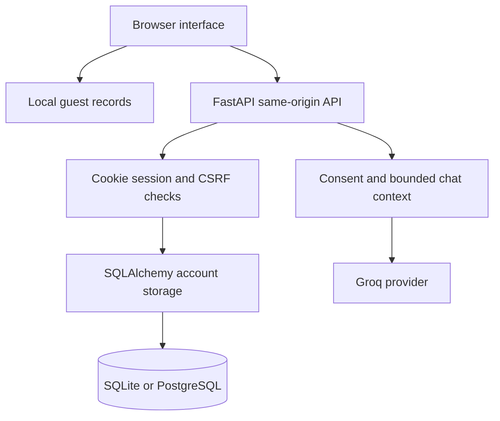

# Architecture

## Boundaries

Guest journal, gratitude and mood records live in `localStorage`. The active focus plan and chat history live in page memory. Switching accounts clears private drafts, chat and the focus plan. Import copies guest records explicitly and does not delete their originals.

Account requests resolve identity from an HttpOnly session cookie. The database stores a hash of the session token. Mutations require an application header, matching Origin when supplied, and CSRF for authenticated operations. The server never accepts a caller-supplied owner ID. Every record read, delete and export is owner-filtered.

Retries reuse `client_id`. The database uniqueness constraint `(user_id, client_id)` prevents duplicate imports. Reusing an ID with different text returns a conflict. Each import batch commits atomically; a multi-batch import can be partially completed and resumed.

Chat is a separate path. Journal text is not automatically used as model context. The latest exchanges are bounded by count and character limits. Provider responses are plain text; errors do not echo secrets or user text. Timeout and cancellation do not promise cancellation of processing already started by the provider.

## Decisions

- Vanilla JavaScript keeps the app inspectable without a framework toolchain. Ordered shared globals remain technical debt.
- SQLite provides a simple local setup; PostgreSQL is required by production configuration.
- Alembic records schema history. V5/V6 adoption validates schema shape before stamping; unknown schemas are rejected.
- One app process preserves the meaning of in-memory global rate/concurrency limits. Horizontal scaling needs a shared limiter.
- The wire protocol remains `4.0.0` for chat compatibility; release version is separately reported as `14.0.0`.
- Static serving exposes only generated `/assets`. Source, credentials and database directories are not mounted.

## Data model

`users` owns `login_sessions` and `entries` through foreign keys with cascading deletion. `schema_version` preserves V5/V6 compatibility; `alembic_version` records migration state. Password changes invalidate every session. A user can hold up to ten sessions and 2,000 entries.

## Daily planner

`planners` holds one JSON document per user, with a revision counter and a cascading user foreign key. POST `/api/planner` validates up to 100 tasks and checks the current revision before updating. A stale revision returns 409. GET uses the session owner; clients cannot choose an owner ID. Export includes planner data, and deleting the account cascades to the planner row.

Guest tasks use a separate browser storage key. Account changes clear visible planner drafts and invalidate pending responses. The planner does not send task text to Groq. Suggestions use local calendar dates, completed/future exclusions, time fit, carried-over status and explicit priority. Starting a suggestion passes a bounded time block into the existing focus workflow; it cannot overwrite an active session or pending review.
